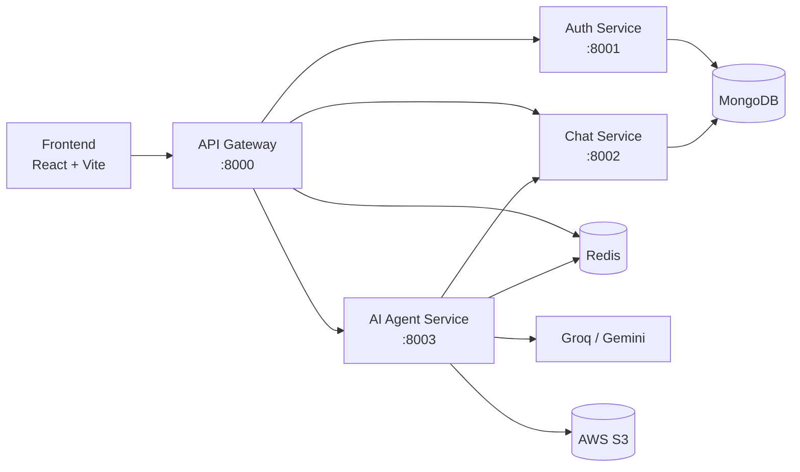

# CortexAI

A multi-agent AI chat platform built with a **microservices architecture**. Users can chat, search the web, generate full websites with a live code preview, create images, PDFs and presentations, all from one interface. An auto-router picks the right agent for each request.

## Features

- **Auto agent routing**: pick an agent manually or let the router decide from the prompt
- **Chat agent**: general conversation with memory of the previous messages
- **Search agent**: web search (Tavily) feeding live results into the answer
- **Coding agent**: generates complete HTML/CSS/JS projects and shows them in an **Artifact panel** (Monaco code editor + live preview)
- **Vision agent**: text to image, stored on AWS S3
- **PDF agent**: generates a downloadable PDF from a topic
- **PPT agent**: generates a downloadable presentation
- **Google login** with Firebase Auth, session stored in Redis
- **Chat history** saved per user in MongoDB
- **Per-agent daily limits** to control usage

## Architecture



| Service | Port | Responsibility |
|---|---|---|
| `gateway` | 8000 | Single entry point. Verifies the session, adds the `x-user-id` header and proxies requests to the right service |
| `auth` | 8001 | Google/Firebase login, user records |
| `chat` | 8002 | Conversations and messages (MongoDB) |
| `ai-agent` | 8003 | LangGraph workflow, router and all AI agents |
| `frontend` | 5173 | React UI |

### How an AI request flows

1. The frontend sends the prompt (and optional file) to `POST /api/agent/chat` as `FormData`.
2. The gateway checks the session cookie in Redis and forwards the request with the user id.
3. The agent service runs the **LangGraph** workflow: `router` picks an agent, the agent runs, and the answer is returned.
4. Messages are saved through the chat service, and the frontend renders the reply (Markdown, images, or an artifact).

## Tech Stack

**Frontend:** React, Vite, Redux Toolkit, Tailwind CSS, Monaco Editor, react-markdown, Motion

**Backend:** Node.js, Express, MongoDB (Mongoose), Redis, express-http-proxy, Multer

**AI:** LangChain, LangGraph, Groq, Google Gemini, Tavily (web search)

**Other:** Firebase Auth, AWS S3, PDFKit, Pexels and Pixabay (website images), Pollinations (image generation)

## Project Structure

```
1.cotexAI/
├── backend/
│   ├── gateway/             # API gateway (proxy + auth check)
│   ├── services/
│   │   ├── auth/            # login service
│   │   ├── chat/            # conversations and messages
│   │   └── ai-agent/        # agents, graph, router, utils
│   │       ├── agents/      # chat, search, coding, vision, pdf, ppt
│   │       ├── graph/       # LangGraph state, router, graph
│   │       ├── config/      # models, memory, limits, S3
│   │       └── utils/       # PDF/PPT generation, S3 upload, image injection
│   └── shared/redis/        # shared Redis client
└── frontend/
    └── src/
        ├── components/      # ChatArea, ChatInput, Artifact, SideBar ...
        ├── redux/           # user, conversation and message slices
        └── features/        # API calls
```

## Getting Started

### Prerequisites

- Node.js 20 or newer
- MongoDB (local or Atlas)
- Redis
- A Firebase project (Google sign-in enabled)
- API keys for Groq and Google AI Studio (Tavily, AWS S3, Pexels and Pixabay are optional per feature)

### 1. Clone and install

```bash
git clone https://github.com/Adiya-Barswal/1.cotexAI.git
cd 1.cotexAI

cd backend/gateway && npm install && cd ../..
cd backend/services/auth && npm install && cd ../../..
cd backend/services/chat && npm install && cd ../../..
cd backend/services/ai-agent && npm install && cd ../../..
cd frontend && npm install
```

### 2. Environment variables

Create a `.env` file in each service folder. Only the variable **names** are listed here. Never commit real values.

**`backend/gateway/.env`**
```
PORT=8000
AUTH_SERVICE=http://localhost:8001
CHAT_SERVICE=http://localhost:8002
AGENT_SERVICE=http://localhost:8003
FRONTEND_URL=http://localhost:5173
REDIS_URL=
```

**`backend/services/chat/.env`**
```
PORT=8002
MONGO_URI=
```

**`backend/services/auth/.env`**
```
PORT=8001
MONGO_URI=
REDIS_URL=
```
The Firebase service account key goes in `backend/services/auth/serviceAccountkey.json` (git-ignored).

**`backend/services/ai-agent/.env`**
```
PORT=8003
MONGO_URI=
REDIS_URL=
CHAT_SERVICE=http://localhost:8002
GROQ_API_KEY=
GOOGLE_API_KEY=
TAVILY_API_KEY=
PEXELS_API_KEY=
PIXABAY_API_KEY=
AWS_REGION=
AWS_BUCKET_NAME=
AWS_ACCESS_KEY_ID=
AWS_SECRET_ACCESS_KEY=
```

**`frontend/.env`**
```
VITE_SERVER_URL=http://localhost:8000
```
The Firebase web config lives in `frontend/utils/firebase.js`.

### 3. Run

Start Redis and MongoDB, then run each service in its own terminal:

```bash
cd backend/gateway && npm run dev
cd backend/services/auth && npm run dev
cd backend/services/chat && npm run dev
cd backend/services/ai-agent && npm run dev
cd frontend && npm run dev
```

Open `http://localhost:5173`.

## Agents

| Agent | What it does | Output |
|---|---|---|
| Chat | Answers questions using conversation history | Markdown text |
| Search | Fetches live web results and answers from them | Markdown text |
| Coding | Classifies intent, then builds a project or explains/reviews code | Chat explanation + artifact (files + preview) |
| Vision | Improves the prompt, generates an image, uploads it to S3 | Image with download link |
| PDF | Asks the model for structured content and builds a PDF | Download link |
| PPT | Builds slides from structured content | Download link |

### Coding agent and images

The model never writes real image URLs, since it cannot verify them. It writes placeholders like `[[img:pizza]]`, and the backend replaces each one with a real photo (Pexels, then Pixabay, then Picsum as the last fallback).

## Security Notes

- Keep `.env` files and `serviceAccountkey.json` out of Git (already in `.gitignore`).
- Rotate any key that was ever shared or committed.
- Only expose ports 80/443 on a server. Keep the service ports (8000 to 8003) private behind a reverse proxy.

## Roadmap

- [ ] Save images and artifacts in chat history (message schema fields)
- [ ] PDF RAG agent (chat with an uploaded PDF)
- [ ] Image analyzer agent (describe an uploaded image)
- [ ] Billing and credits service (Razorpay)
- [ ] Streaming responses
- [ ] CI/CD with GitHub Actions
- [ ] Deployment on AWS EC2 with Nginx and PM2

## Author

**Aditya Singh Barswal**: [GitHub](https://github.com/Adiya-Barswal)
